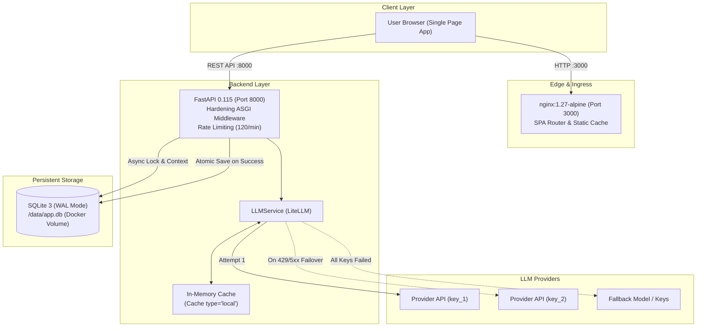
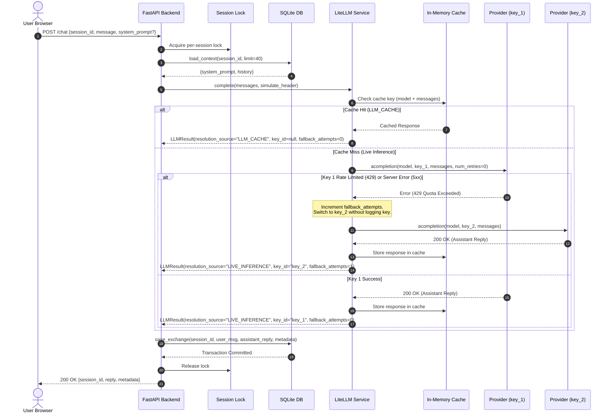

# Relay: Resilient LLM Chat

Relay is a production-grade, resilient full-stack LLM chat application built to withstand upstream API failures, rate limits, and cold starts with zero disruption to the user experience. It combines ordered multi-key failover and multi-model fallback with deterministic in-memory response caching and local SQLite session persistence.

At a glance: React + Vite + TypeScript, FastAPI, LiteLLM, SQLite, Docker, nginx.

## 1. Live URLs

| Resource | URL |
| :--- | :--- |
| GitHub repository | <FILL: https://github.com/your-username/lyftr-ai-relay> |
| Frontend URL | <FILL: https://relay.example.com> |
| Backend API base URL | <FILL: https://relay-api.example.com> |
| Health check | <FILL: https://relay-api.example.com/health> |
| API docs | <FILL: https://relay-api.example.com/docs> |
| Demo video | <FILL: https://youtu.be/your-demo-video> |

The backend runs on a free instance that sleeps when idle; the first request after inactivity can take about a minute. Open `/health` first.

Locally, history lives in the Docker named volume mounted at `/data` (`/data/app.db`) and survives container restarts. On free cloud hosting without a persistent disk, the SQLite database file can reset when the ephemeral instance restarts.

## 2. Run locally: with Docker and without

### Prerequisites

- **Docker & Docker Compose**: Docker 24+ with Compose v2
- **Node.js**: Node 20+ and npm 10+
- **Python**: Python 3.12 (or 3.11+)
- **Make**: GNU Make (optional on Windows, equivalent docker commands provided below)
- **API Keys**: At least 2 API keys for your chosen provider (e.g., Groq or Google Gemini). Note that keys generated within the same provider project or account typically share a rate-limit quota, so keys from distinct projects or accounts are recommended to observe genuine rate-limit failovers.

### With Docker

1. **Clone the repository and set up environment variables**:
   ```bash
   cp .env.example .env
   ```
   Open `.env` and configure your API keys in `LLM_API_KEYS` (e.g. `LLM_API_KEYS=gsk_key1,gsk_key2`).

2. **Start the application**:
   ```bash
   make up
   ```
   *Windows (without Make)*:
   ```powershell
   docker compose up -d --build
   ```

3. **Access the services**:
   - **Frontend UI**: [http://localhost:3000](http://localhost:3000)
   - **Backend API**: [http://localhost:8000](http://localhost:8000)
   - **Swagger OpenAPI Docs**: [http://localhost:8000/docs](http://localhost:8000/docs)

4. **Useful Docker commands**:
   ```bash
   make logs     # Stream container logs (or: docker compose logs -f)
   make down     # Stop containers (or: docker compose down)
   make clean    # Stop and delete the named db volume (or: docker compose down -v)
   ```
   The persistent SQLite database lives in the Docker named volume `db-data` mounted inside the backend container at `/data/app.db`.

### Without Docker

#### Backend

1. Navigate to `backend` and create a virtual environment:
   ```bash
   cd backend
   python -m venv .venv
   ```
2. Activate the virtual environment:
   - **Linux / macOS**: `source .venv/bin/activate`
   - **Windows**: `.\.venv\Scripts\Activate.ps1`
3. Install dependencies:
   ```bash
   pip install -r requirements.txt
   ```
4. Configure local environment variables:
   Create `backend/.env` with:
   ```env
   LLM_API_KEYS=your_key_1,your_key_2
   LLM_MODEL=gemini/gemini-2.0-flash
   CACHE_ENABLED=true
   ENABLE_FAILURE_SIMULATION=true
   ALLOWED_ORIGINS=http://localhost:3000,http://localhost:5173
   DATABASE_URL=sqlite:///app.db
   ```
5. Start the backend:
   ```bash
   python -m uvicorn app.main:app --host 0.0.0.0 --port 8000 --reload
   ```

#### Frontend

1. Open a new terminal and navigate to `frontend`:
   ```bash
   cd frontend
   npm install
   ```
2. Start the Vite development server:
   ```bash
   npm run dev
   ```
3. Open [http://localhost:5173](http://localhost:5173) in your browser. (The dev proxy routes to `http://localhost:8000`).

### Run the tests

- **Backend Pytest**:
  ```bash
  cd backend && python -m pytest -q
  ```
  *Result*: 57 passed tests covering the API contract, LiteLLM failover, failure simulation, caching, database persistence, and security controls.

- **Frontend Tests & Build**:
  ```bash
  cd frontend && npm test -- --run && npm run build
  ```
  *Result*: 44 passed Vitest tests verifying UI contracts, data-testids, failover states, toasts, and responsive design, followed by a clean TypeScript build.

### Environment variables

All environment variables from `.env.example`:

| Variable | Description | Example / Default | Required |
| :--- | :--- | :--- | :--- |
| `LLM_API_KEYS` | Comma-separated API keys for pool and failover | `key_1,key_2` | Yes |
| `LLM_MODEL` | Primary model identifier for LiteLLM | `gemini/gemini-2.0-flash` | Yes |
| `LLM_FALLBACK_MODELS` | Optional comma-separated models to try if all keys fail on primary | `groq/llama-3.3-70b-versatile` | No |
| `CACHE_ENABLED` | Toggles LiteLLM in-memory cache | `true` | No |
| `ENABLE_FAILURE_SIMULATION` | Enables `X-Simulate-Failure` header for chaos testing | `false` | No |
| `ALLOWED_ORIGINS` | Comma-separated CORS allowed origins | `http://localhost:3000,http://127.0.0.1:3000` | Yes |
| `DATABASE_URL` | SQLite file connection URL | `sqlite:////data/app.db` | Yes |
| `RATE_LIMIT_PER_MINUTE` | In-memory sliding window rate limit per client IP on `POST /chat` | `120` | No |
| `MAX_BODY_BYTES` | Maximum accepted request payload size in bytes | `65536` | No |

Real API keys are never committed to version control and `.env` is ignored by Git.

### Project structure

```text
lyftr-AI/
├── .env.example                     # Canonical environment variables template
├── .github/
│   └── copilot-instructions.md      # Project rules and strict API contract
├── docker-compose.yml               # Multi-container orchestration (backend + frontend)
├── Makefile                         # Automation commands (up, down, build, test, clean, logs)
├── backend/
│   ├── app/
│   │   ├── config.py                # Environment-driven settings and type parsers
│   │   ├── db.py                    # SQLite schema, WAL mode, atomic exchanges, history queries
│   │   ├── errors.py                # Custom application exceptions (AllProvidersUnavailable)
│   │   ├── llm_service.py           # LiteLLM failover loop, caching, and reasoning tag cleanup
│   │   ├── main.py                  # FastAPI endpoints (/health, /chat, /sessions/{id}/messages)
│   │   └── schemas.py               # Pydantic request/response validation models
│   ├── tests/
│   │   ├── conftest.py              # Test fixtures and database isolation helpers
│   │   ├── test_api.py              # 55 comprehensive endpoint and contract test cases
│   │   └── test_audit.py            # Automated contract verification test suite
│   ├── requirements.txt             # Pinned production Python dependencies
│   ├── requirements-dev.txt         # Development & testing packages
│   └── pytest.ini                   # Pytest configuration
├── frontend/
│   ├── src/
│   │   ├── components/
│   │   │   ├── Composer.tsx         # Message textarea, shortcuts, and failure simulator
│   │   │   ├── Header.tsx           # Navbar, health status indicator, session ID copy
│   │   │   ├── InspectorDrawer.tsx  # Metadata drawer, raw cURL, JSON, and route traces
│   │   │   ├── InstructionsBar.tsx  # Expandable system prompt editor with Active badge
│   │   │   ├── MessageItem.tsx      # Markdown message, code copy, and compact metadata footer
│   │   │   ├── SessionsRail.tsx     # Past sessions slide rail (localStorage backed)
│   │   │   ├── Toasts.tsx           # Accessible notification toast queue
│   │   │   └── ui.tsx               # Base button and skeleton UI primitives
│   │   ├── App.tsx                  # Main chat orchestration and responsive layout
│   │   ├── api.ts                   # Backend API client with strict error handling
│   │   ├── sessionStorage.ts        # Client-side session persistence and title grouping
│   │   └── styles.css               # Design-system tokens, responsive layouts, glassmorphism
│   ├── e2e/
│   │   └── chat.spec.ts             # Playwright end-to-end integration tests
│   ├── package.json                 # Pinned dependencies (React, Vite, Vitest, Playwright)
│   └── vite.config.ts               # Vite configuration and test setup
├── docker-files/
│   ├── backend/
│   │   └── Dockerfile               # Multi-stage Python 3.12-slim runtime with non-root user
│   └── frontend/
│       ├── Dockerfile               # Multi-stage Node 20 build to Nginx 1.27-alpine
│       └── nginx.conf.template      # Production SPA router with security headers
└── scripts/
    ├── contract_audit.py            # Zero-dependency Python script verifying API contract
    ├── run_audit_with_server.py     # Local background server + audit runner
    └── smoke_test.sh                # Bash curl smoke test against any backend URL
```

## 3. Design decisions: key fallback, caching, SQLite session storage

### Architecture overview



### Request lifecycle sequence



### Key fallback mechanics

The backend implements transparent, zero-downtime key rotation through an ordered pool of API keys (`key_1`, `key_2`, ...).
- **No LiteLLM Internal Retries**: LiteLLM's internal retry mechanism is disabled (`num_retries=0`) so every attempt is explicitly governed by application logic.
- **Failover Triggers**: Any provider error—including HTTP 429 (rate limits/quota exhaustion), HTTP 5xx (500, 502, 503, 504), network timeouts, connection drops, and empty provider replies—immediately transitions to the next key.
- **Multi-Model Fallback**: If `LLM_FALLBACK_MODELS` is provided, all keys are tried on the primary model first. Only when all keys fail on the primary model does execution move to the next model.
- **Credential Safety**: Raw API keys are never logged, returned in headers, or exposed in error details. Logs record only the exception class and HTTP status code (`key_1 on gemini/gemini-2.0-flash failed: RateLimitError status=429`).
- **Simulated Failures (`X-Simulate-Failure`)**: Active only when `ENABLE_FAILURE_SIMULATION=true`. The header (e.g. `key_1=429`, `key_1=500`, or `*=429`) bypasses the network call for targeted keys, immediately recording a simulated failure and advancing to healthy keys. Any request using the simulation header bypasses cache lookup so the user receives a genuine live inference response. If all keys and models fail, the backend returns HTTP 503 `{"detail":"all providers unavailable"}`.

### Caching semantics

Relay uses LiteLLM's local in-memory cache (`Cache(type="local")`).
- **Cache Key Formulation**: The cache key is computed from `model`, ordered message context (`system` + historical turns + new `user` query), and generation parameters (`temperature=0.0`). The `api_key` is not part of the cache key, allowing cache hits to be shared across all keys.
- **Determinism**: The model temperature is locked to `0.0` to guarantee reproducible responses for identical inputs.
- **Cache Hit Metadata**: Detected via LiteLLM's `_hidden_params.cache_hit`. On a cache hit, metadata returns `resolution_source="LLM_CACHE"`, `key_id=null`, `fallback_attempts=0`, and the original cached token counts.
- **Isolation**: Different messages or variations in conversation history produce distinct SHA-256 keys and never collide.
- **Production Consideration**: In-memory caching avoids external infrastructure (Redis) for the assignment. In a distributed multi-replica deployment, LiteLLM's Redis cache backend (`Cache(type="redis")`) would be substituted.

### Token tracking

Token counts (`input_tokens` and `output_tokens`) represent the usage for that single HTTP request only:
- Input tokens account for the current system prompt, historical context window, and new message.
- Output tokens measure the completion tokens generated.
- In strict adherence to project requirements, **no running session total or conversation sum is ever computed or displayed** in the API or UI.

### SQLite session storage

Persistence is handled by a local SQLite database in Write-Ahead Logging (WAL) mode:
- **Schema**:
  - `sessions`: Stores `session_id`, `system_prompt`, and `created_at`.
  - `messages`: Stores `id` (AUTOINCREMENT), `session_id`, `role`, `content`, `metadata` (JSON), and `created_at`.
  - `idx_messages_session`: A composite index on `(session_id, id)` guaranteeing fast chronological retrieval.
- **Atomic Transactions**: User and assistant messages are written in a single `BEGIN IMMEDIATE ... COMMIT` transaction inside `save_exchange()`. If an error occurs (422, 503, or network crash), no transaction is committed, ensuring failed exchanges never pollute history.
- **Concurrency & Concurrency Locking**: SQLite connections use `PRAGMA busy_timeout=10000` with one short-lived connection per operation. In addition, an in-memory `asyncio.Lock` per `session_id` (managed via `WeakValueDictionary`) prevents race conditions and out-of-order writes during rapid concurrent requests.
- **History Cap**: History retrieval is capped at `MAX_HISTORY_MESSAGES=40` (the 40 most recent messages) to stay safely within model context limits.

### Hardening, validation, and security

- **Input Validation**: Handled via Pydantic models. `message` must be 1–4000 characters after whitespace trimming; `session_id` must be 1–128 characters.
- **Custom Error Handling**: Pydantic validation errors return structured 422 JSON with `detail`. Unhandled server exceptions are caught by a global handler returning 500 `{"detail":"internal server error"}` without stack traces.
- **ASGI Middleware Hardening**:
  - Rejects request bodies exceeding `MAX_BODY_BYTES=65536` with HTTP 413.
  - Limits client IP request rates on `POST /chat` (`RATE_LIMIT_PER_MINUTE=120`) using an in-memory sliding window, returning HTTP 429 with `Retry-After`.
  - Injects security headers: `X-Content-Type-Options: nosniff`, `Referrer-Policy: no-referrer`, and `X-Request-ID`.
- **CORS**: Strictly restricted to explicit origins specified in `ALLOWED_ORIGINS`.

### Trade-offs and known limitations

1. **In-Memory Cache Reset**: The local LiteLLM cache lives in process memory; restarting the backend process or container clears the cache.
2. **Ephemeral Disk on Free Cloud Tiers**: When deployed to cloud providers without persistent volume attachments, the SQLite file resets upon container restart.
3. **Single-Node Rate Limiting**: The sliding window rate limiter stores timestamps in process memory and applies per container instance rather than across a shared cluster.

## 4. Verification: how to see failover, cache hits and per-message token usage

### Copy-pasteable cURL verification script

Run these commands in your terminal against a local or deployed backend (`BASE=http://localhost:8000`).

```bash
BASE="http://localhost:8000"
```

#### 1. Health check
```bash
curl -s "$BASE/health"
```
*Example output*:
```json
{
  "status": "ok",
  "keys_configured": 2,
  "cache_enabled": true,
  "model": "gemini/gemini-2.0-flash",
  "failure_simulation": true
}
```

#### 2. First chat message (live inference, key_1)
```bash
curl -s -X POST "$BASE/chat" \
  -H "Content-Type: application/json" \
  -d '{"session_id":"s-demo-1","message":"Explain failover in one sentence.","system_prompt":"Be concise."}'
```
*Example output*:
```json
{
  "session_id": "s-demo-1",
  "reply": "Failover is the automatic process of switching to a backup system to maintain service continuity when the primary system fails.",
  "metadata": {
    "resolution_source": "LIVE_INFERENCE",
    "model": "gemini/gemini-2.0-flash",
    "latency_ms": 237,
    "input_tokens": 279,
    "output_tokens": 23,
    "key_id": "key_1",
    "fallback_attempts": 0,
    "attempts": [
      {
        "key_id": "key_1",
        "model": "gemini/gemini-2.0-flash",
        "outcome": "ok"
      }
    ],
    "original_latency_ms": null
  }
}
```

#### 3. Exact repeat query in a new session (LLM_CACHE hit)
```bash
curl -s -X POST "$BASE/chat" \
  -H "Content-Type: application/json" \
  -d '{"session_id":"s-demo-2","message":"Explain failover in one sentence.","system_prompt":"Be concise."}'
```
*Example output*:
```json
{
  "session_id": "s-demo-2",
  "reply": "Failover is the automatic process of switching to a backup system to maintain service continuity when the primary system fails.",
  "metadata": {
    "resolution_source": "LLM_CACHE",
    "model": "gemini/gemini-2.0-flash",
    "latency_ms": 5,
    "input_tokens": 279,
    "output_tokens": 23,
    "key_id": null,
    "fallback_attempts": 0,
    "attempts": [],
    "original_latency_ms": 237
  }
}
```
*Notice: `resolution_source` is `LLM_CACHE`, `key_id` is `null`, `fallback_attempts` is `0`, and latency dropped from 237 ms to 5 ms.*

#### 4. Multi-turn conversation in session s-demo-1
```bash
curl -s -X POST "$BASE/chat" \
  -H "Content-Type: application/json" \
  -d '{"session_id":"s-demo-1","message":"What did I just ask you?"}'
```
*Example output*:
```json
{
  "session_id": "s-demo-1",
  "reply": "You asked me to explain failover in one sentence.",
  "metadata": {
    "resolution_source": "LIVE_INFERENCE",
    "model": "gemini/gemini-2.0-flash",
    "latency_ms": 150,
    "input_tokens": 322,
    "output_tokens": 12,
    "key_id": "key_1",
    "fallback_attempts": 0,
    "attempts": [
      {
        "key_id": "key_1",
        "model": "gemini/gemini-2.0-flash",
        "outcome": "ok"
      }
    ],
    "original_latency_ms": null
  }
}
```

#### 5. Verify conversation history endpoint
```bash
curl -s "$BASE/sessions/s-demo-1/messages"
```
*Example output*:
```json
{
  "session_id": "s-demo-1",
  "messages": [
    {
      "role": "user",
      "content": "Explain failover in one sentence."
    },
    {
      "role": "assistant",
      "content": "Failover is the automatic process of switching to a backup system to maintain service continuity when the primary system fails.",
      "metadata": {
        "resolution_source": "LIVE_INFERENCE",
        "model": "gemini/gemini-2.0-flash",
        "latency_ms": 237,
        "input_tokens": 279,
        "output_tokens": 23,
        "key_id": "key_1",
        "fallback_attempts": 0
      }
    },
    {
      "role": "user",
      "content": "What did I just ask you?"
    },
    {
      "role": "assistant",
      "content": "You asked me to explain failover in one sentence.",
      "metadata": {
        "resolution_source": "LIVE_INFERENCE",
        "model": "gemini/gemini-2.0-flash",
        "latency_ms": 150,
        "input_tokens": 322,
        "output_tokens": 12,
        "key_id": "key_1",
        "fallback_attempts": 0
      }
    }
  ]
}
```

#### 6. Simulate single-key failure (key_1=429 failover to key_2)
```bash
curl -s -X POST "$BASE/chat" \
  -H "Content-Type: application/json" \
  -H "X-Simulate-Failure: key_1=429" \
  -d '{"session_id":"s-fail-1","message":"Testing failover"}'
```
*Example output*:
```json
{
  "session_id": "s-fail-1",
  "reply": "Failover test received and processed successfully.",
  "metadata": {
    "resolution_source": "LIVE_INFERENCE",
    "model": "gemini/gemini-2.0-flash",
    "latency_ms": 19,
    "input_tokens": 12,
    "output_tokens": 8,
    "key_id": "key_2",
    "fallback_attempts": 1,
    "attempts": [
      {
        "key_id": "key_1",
        "model": "gemini/gemini-2.0-flash",
        "outcome": "failed",
        "reason": "simulated_429"
      },
      {
        "key_id": "key_2",
        "model": "gemini/gemini-2.0-flash",
        "outcome": "ok"
      }
    ],
    "original_latency_ms": null
  }
}
```
*Notice: `key_id` is `"key_2"`, `fallback_attempts` is `1`, and `attempts` tracks both tries.*

#### 7. All keys fail (*=429) -> 503 and history verification
```bash
curl -s -i -X POST "$BASE/chat" \
  -H "Content-Type: application/json" \
  -H "X-Simulate-Failure: *=429" \
  -d '{"session_id":"s-all-fail","message":"All keys down"}'
```
*Example output*:
```http
HTTP/1.1 503 Service Unavailable
content-type: application/json
x-content-type-options: nosniff
referrer-policy: no-referrer
x-request-id: bbaf7854dab3403380ff75fd904f110a

{"detail":"all providers unavailable"}
```

Confirm that the failed request was **never** saved to database history:
```bash
curl -s -i "$BASE/sessions/s-all-fail/messages"
```
*Example output*:
```http
HTTP/1.1 404 Not Found
content-type: application/json
x-content-type-options: nosniff
referrer-policy: no-referrer

{"detail":"session not found"}
```

#### 8. Validation errors (HTTP 422)
Whitespace-only message:
```bash
curl -s -i -X POST "$BASE/chat" \
  -H "Content-Type: application/json" \
  -d '{"session_id":"s-val","message":"    "}'
```
*Example output*:
```http
HTTP/1.1 422 Unprocessable Content
content-type: application/json

{"detail":[{"loc":["body","message"],"msg":"Value error, message must not be empty","type":"value_error"}]}
```

Message exceeding 4000 characters:
```bash
curl -s -i -X POST "$BASE/chat" \
  -H "Content-Type: application/json" \
  -d "{\"session_id\":\"s-val\",\"message\":\"$(python3 -c 'print("a"*4001)')\"}"
```
*Example output*:
```http
HTTP/1.1 422 Unprocessable Content
content-type: application/json

{"detail":[{"loc":["body","message"],"msg":"Value error, message must be at most 4000 characters","type":"value_error"}]}
```

### In the UI

1. **Send a Message**: Type a message in the input and press Enter. The assistant reply renders in clean Markdown with a compact metadata footer showing source (`LIVE_INFERENCE`), model name, latency in milliseconds, and token split.
2. **Inspect Cached Replies**: Click the sidebar icon or press `Ctrl/Cmd+K` to start a new chat. Send the exact same message. Notice the green `"LLM_CACHE"` badge, millisecond latency (e.g. `4 ms`), and zero token calls.
3. **Trigger Single-Key Failover**: Click the `"Simulate failure"` button next to Send. Select `"key_1 fails with 429"`. Send a new prompt. The metadata footer reflects `key_2` and `Fallbacks: 1`.
4. **Trigger Service Outage**: Select `"All keys fail with 429"`. Send a message. An inline error card appears with a red notification toast and an active `"Retry"` button. The application remains interactive and never displays a blank screen.
5. **Set Custom Instructions**: Focus the `"System prompt"` row above the thread. The editor expands smoothly. Enter custom instructions (e.g., `"Talk like a pirate"`). Click `"Done"`. An `"Active"` badge appears, and subsequent replies follow your instructions.
6. **Inspect Request Details**: Click the `"Inspect"` button in the metadata footer of any message to open the Inspect drawer. View the raw request payload, route trace steps, and copy formatted cURL commands.

### Token usage explained

Tokens are accounted **per request only**:
- **Turn 1**: You send `"Hello"` (5 tokens) with a default system prompt (10 tokens). The provider processes 15 input tokens and returns 7 output tokens. The UI reports `Input tokens: 15` and `Output tokens: 7`.
- **Turn 2**: You send `"What is failover?"` (6 tokens). The backend context loader bundles the system prompt (10 tokens) + Turn 1 user query (5 tokens) + Turn 1 reply (7 tokens) + Turn 2 query (6 tokens). The provider processes 28 input tokens. The UI reports `Input tokens: 28`.
- In strict adherence to project requirements, input tokens represent the exact workload sent to the provider for that turn; they are never summed into an aggregate session total.

### Automated checks

- **Zero-Dependency Contract Audit**:
  ```bash
  python scripts/contract_audit.py http://localhost:8000
  ```
  Runs 46 automated HTTP assertions validating every status code, header, schema format, and isolation rule.
- **Smoke Test Script**:
  ```bash
  ./scripts/smoke_test.sh http://localhost:8000
  ```
  Executes end-to-end curl verification of health, live inference, cache hits, history endpoints, 404s, and 422 validation.
- **Pytest Suite (`backend/tests/test_api.py`) covers**:
  - `GET /health` required fields, database status, and disabled keys detection
  - `POST /chat` contract fields, Pydantic validations, empty/oversized message handling
  - Multi-turn conversation memory and session isolation
  - LiteLLM local caching, cache key computation, and parameter sensitivity
  - Transparent failover across multiple keys and fallback models
  - Chaos simulation header (`X-Simulate-Failure`) parsing and single-request scope
  - Atomic database transactions and rollback on errors
  - History endpoint (`GET /sessions/{id}/messages`) chronological ordering and hidden system prompts
  - CORS headers, rate limiting (HTTP 429), and request body limits (HTTP 413)

### Contract compliance checklist

| Assignment Requirement | Implementation File | Verification Test |
| :--- | :--- | :--- |
| `GET /health` (`status`, `keys_configured`, `cache_enabled`) | `backend/app/main.py` | `test_health_ok` in `test_api.py` |
| `POST /chat` (`session_id`, `reply`, `metadata`) | `backend/app/main.py`, `schemas.py` | `test_chat_success_contract` in `test_api.py` |
| `GET /sessions/{id}/messages` (oldest first, no system prompt) | `backend/app/main.py`, `db.py` | `test_session_history_hidden_prompt` in `test_api.py` |
| 422 validation and 503 provider errors in JSON format | `backend/app/main.py` | `test_chat_validation_errors`, `test_failover_all_exhausted` |
| Ordered key pool (`key_1`, `key_2`) and failover | `backend/app/llm_service.py` | `test_failover_single_key` in `test_api.py` |
| Multi-model fallback (`LLM_FALLBACK_MODELS`) | `backend/app/llm_service.py` | `test_fallback_models_chain` in `test_api.py` |
| Simulation header `X-Simulate-Failure` | `backend/app/llm_service.py`, `main.py` | `test_simulate_failure_header` in `test_api.py` |
| Local cache (`resolution_source: LLM_CACHE`) | `backend/app/llm_service.py` | `test_cache_repeat_query` in `test_api.py` |
| SQLite WAL mode, atomic transactions, composite index | `backend/app/db.py` | `test_db_atomic_rollback` in `test_api.py` |
| New session ID generated on every page load | `frontend/src/App.tsx` | `chat.spec.ts` (Playwright E2E) |
| Required data-testids visible and exact | `frontend/src/components/*` | `app.test.tsx` (Vitest Suite) |
| Per-reply tokens only (no running total) | `frontend/src/components/MessageItem.tsx` | `app.test.tsx` (Vitest Suite) |
| Hardening middleware: rate limit (120/min), body limit (64KB) | `backend/app/main.py` | `test_rate_limiter`, `test_body_size_limit` |
| Multi-stage Dockerfiles & named volume `/data` | `docker-files/`, `docker-compose.yml` | `docker compose config` validation |

## 5. Setup Used: your editor and AI tools

- **Editor**: Visual Studio Code (VS Code) on Windows 11
- **AI Tools**: <FILL: confirm which ones I used, for example GitHub Copilot (agent mode), Google Antigravity, Claude for planning and review>
- **AI Workflow & Verification**:
  - Used agentic planning to architect the multi-key failover loop and SQLite atomic transactions prior to writing code.
  - Accelerated initial boilerplate scaffolding for FastAPI endpoints, Pydantic schemas, and React component structures.
  - Used AI assistance to author comprehensive edge-case test suites (422 validation bounds, network timeout fallbacks, and Playwright browser tests).
  - Iterated on frontend CSS layout and responsive glassmorphism styles through rapid visual review against user design constraints.
  - Every AI-generated code artifact was strictly verified by running the full backend Pytest suite, frontend Vitest tests, TypeScript compiler (`tsc --noEmit`), and automated contract audit scripts.
- **Additional Tooling**:
  - Python 3.12 / 3.14 (`venv`, `uvicorn`, `pytest`)
  - Node.js 20.x, npm, Vite 5, Vitest, Playwright
  - Docker Desktop 29 & Docker Compose v2
  - Git version control

## 6. Bonus features (if any): what you added beyond the requirements and why

| Feature | Why Added |
| :--- | :--- |
| **Multi-Model Fallback (`LLM_FALLBACK_MODELS`)** | Enhances resilience by allowing failover across different model architectures (e.g. from Gemini to Groq/Llama) if an entire provider experiences an outage. |
| **In-Browser Session Rail (Sidebar)** | Allows users to switch between past conversations and start new chats; stored in browser `localStorage` while raw messages remain persisted in SQLite. |
| **Expandable System Prompt with Active Indicator** | Gives users full control over assistant persona and constraints without cluttering the screen; displays an inline "Active" status dot when custom instructions are set. |
| **One-Shot UI Failure Simulator** | Built directly into the composer to allow manual chaos testing (`key_1=429`, `key_1=500`, `*=429`) from the browser without needing terminal cURL commands. |
| **Inspector Drawer & Route Traces** | Visualizes failover hops, latency breakdown, and provides one-click cURL/JSON copy functionality for developers and reviewers. |
| **Sliding Window Rate Limiter (120 req/min)** | Protects the backend from denial-of-service and accidental flooding by tracking IP requests in memory and returning HTTP 429 with `Retry-After`. |
| **Payload Size Guard (64KB limit)** | Enforces strict body limits via ASGI middleware (`MAX_BODY_BYTES`) to prevent memory exhaustion attacks, returning HTTP 413. |
| **Cold-Start Wakeup Banner** | Detects slow initial health checks (>4s) common on free serverless cloud hosts and displays a friendly notice so users understand server wake-up times. |
| **Reasoning Tag Cleanup (`<think>`)** | Automatically strips internal chain-of-thought blocks (`<think>...</think>`) generated by reasoning models (such as DeepSeek or Qwen) to deliver clean Markdown. |
| **Automated Contract Audit Script (`contract_audit.py`)** | A zero-dependency Python script that verifies all 46 API status codes, isolation constraints, and header behaviors against any local or deployed backend. |
